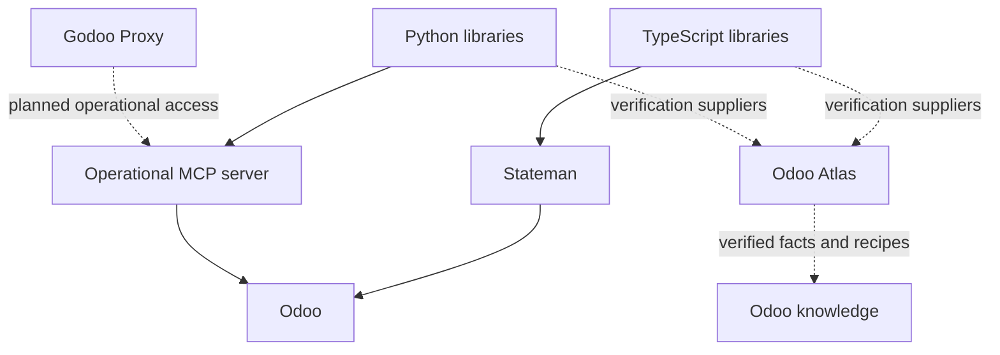

# Godoo

**Make Odoo easier to automate, configure and understand.**

Godoo brings together TypeScript and Python libraries, declarative configuration,
operational tools for agents, and verifiable Odoo knowledge. The projects share
useful foundations while keeping independent versions and release cycles.

## The portfolio

| Project | What it does | Distribution |
| --- | --- | --- |
| [TypeScript libraries](https://github.com/godoo-dev/godoo-ts) | Odoo client, model introspection and disposable Odoo test environments | [`@godoo-dev/client`](https://www.npmjs.com/package/@godoo-dev/client), [`@godoo-dev/introspection`](https://www.npmjs.com/package/@godoo-dev/introspection), [`@godoo-dev/testcontainers`](https://www.npmjs.com/package/@godoo-dev/testcontainers) |
| [Python libraries](https://github.com/godoo-dev/godoo-py) | Language-native client, introspection and disposable Odoo test environments | [`godoo`](https://pypi.org/project/godoo/), [`godoo-client`](https://pypi.org/project/godoo-client/), [`godoo-introspection`](https://pypi.org/project/godoo-introspection/), [`godoo-testcontainers`](https://pypi.org/project/godoo-testcontainers/) |
| [Stateman](https://github.com/godoo-dev/godoo-stateman) | Compose desired configuration, review a plan, apply changes and detect drift | [`@godoo-dev/stateman`](https://www.npmjs.com/package/@godoo-dev/stateman) |
| [Operational MCP server](https://github.com/godoo-dev/godoo-mcp-server) | Agent access to Odoo through each user's permissions | [`godoo-mcp-server`](https://pypi.org/project/godoo-mcp-server/) |
| Odoo Atlas | Odoo facts and recipes, human-facing views and a separate read-only knowledge MCP | Private product in development |
| Godoo Proxy | Hosted OAuth/SSO gateway for per-user operational Odoo access | Private product in development |
| Godoo HQ | Product intent and coordination across the portfolio | Private coordination repository |

## How the projects fit together

Atlas's knowledge interface and the operational MCP server serve different needs.
Atlas explains Odoo; the operational server lets agents work with an Odoo instance.
Proxy's complete SSO-to-Odoo flow remains in development.

## Verification and releases

**Odoo 18 is the supported baseline.** Later majors need explicit qualification
after the same candidate passes 18. Odoo 17 is outside active support.

Every maintained repository exposes a native check entrypoint and an authoritative
CI result named `required`. Package checks install built tarballs or wheels in
isolated consumers. Applicable integration checks run against disposable Odoo
instances and record the observed server version. Atlas also checks its browser,
knowledge and installed-package interfaces; Proxy checks its gateway foundation
through an isolated HTTP process.

HQ coordinates release scope and dependency order; each project owns its versions,
changelog and native publisher. Package release workflows validate the candidate and
promote the tested archive bytes. Image publication has its own verification and
recovery requirements. A successful CI run is distinct from a
published release, deployed service or application acceptance.

| Public project | CI |
| --- | --- |
| TypeScript |  |
| Python |  |
| Stateman |  |
| Operational MCP |  |

## Recent work

- Adopted an Odoo 18 baseline and consistent required CI checks across the portfolio.
- Added isolated package-consumer checks and hosted verification of tested release artifacts.
- Strengthened Stateman's reviewed plans, dependency ordering, recovery and fixture workflows.
- Separated operational MCP access from Atlas knowledge access and customer deployments.

See each public repository's changelog and releases for shipped changes and its
verification guide for the checks and their limits.

## Getting started

Choose the [TypeScript](https://github.com/godoo-dev/godoo-ts) or
[Python](https://github.com/godoo-dev/godoo-py) libraries for application code,
[Stateman](https://github.com/godoo-dev/godoo-stateman) for declarative configuration,
or the [MCP server](https://github.com/godoo-dev/godoo-mcp-server) for operational
agent access. Follow the selected project's requirements, examples and license.
